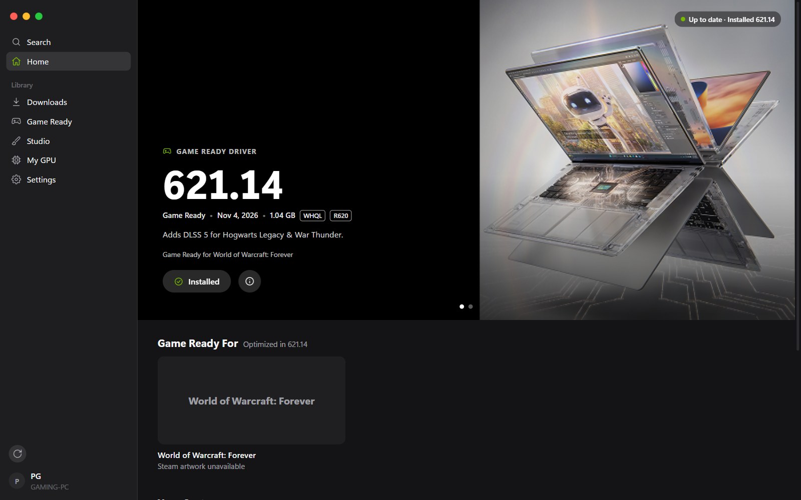
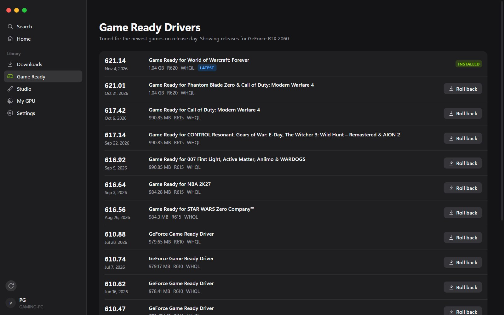
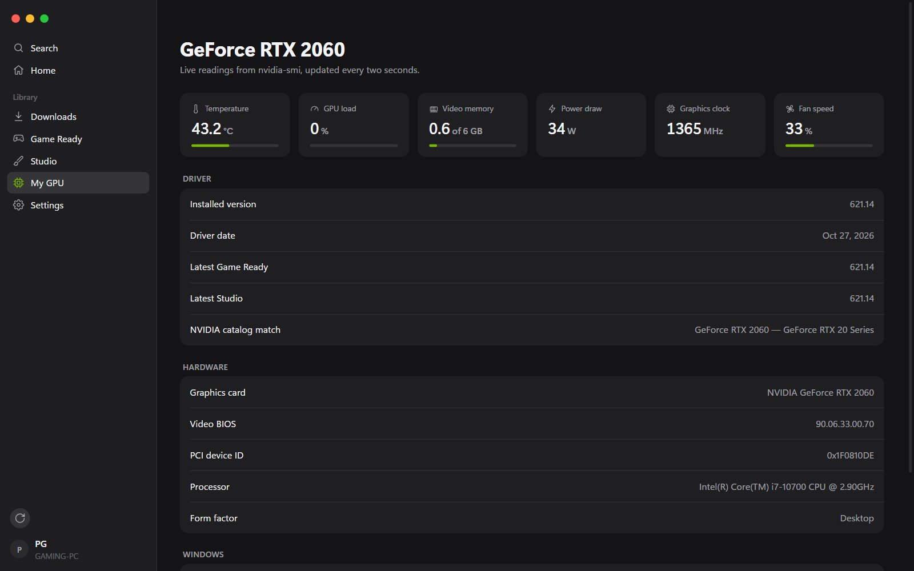

# Verdant

Your GeForce driver, always current. A small native app for Windows 10 and 11, by PG.

**[Download the latest release](https://github.com/lilpatter/verdant/releases/latest)**: `Verdant_<version>_x64-setup.exe` installs it, `verdant.exe` runs without installing.

More at [lilpatter.github.io/verdant](https://lilpatter.github.io/verdant/).

## What it does

- Detects your GPU and installed driver, and whether you're on a desktop or laptop.
- Matches your exact card with NVIDIA's catalog and finds the latest **Game Ready** and **Studio** drivers.
- Downloads installers to `Downloads\NVIDIA Drivers` with pause, resume and cancel.
- Only runs installers signed by *NVIDIA Corporation*.
- Installs with one prompt: **Express** (silent, optional clean install) or **Custom** (NVIDIA's own installer), then confirms the new driver is active.
- Release history for both channels, with roll back and release notes.
- Live GPU temperature, load, VRAM, power, clock and fan.
- Steam artwork for the games each driver targets.

## Screenshots

  
  

## Requirements

Windows 10 or 11 with an NVIDIA GeForce graphics card and the WebView2 runtime, which ships with Windows 11.

Verdant is a Windows app. There's no Mac version yet: the Mac-style sidebar and window buttons are just part of its design.

## Updates

Verdant updates itself from this page's releases and checks each download against GitHub's SHA-256 digest. Turn it off under Settings › About.

## Credits

Made by [PG](https://lilpatter.github.io).

Not affiliated with NVIDIA. GeForce, Game Ready and Studio are trademarks of NVIDIA Corporation.

---

© 2026 PG. All rights reserved. Verdant is free to download and use. Its source code is not public.
